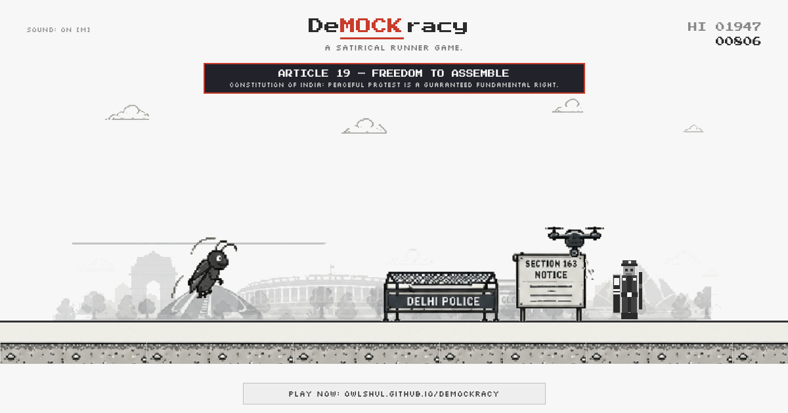

# DeMOCKracy 🪳

> *A satirical runner game.*



---

## 🎮 How to Play

| Action | Desktop | Mobile |
|--------|---------|--------|
| Jump | `Space` / `↑` | Tap `⬆ JUMP` or upper screen |
| Duck | `↓` | Tap `⬇ DUCK` or lower screen |
| Select character | `← →` | Tap character / arrows |
| Start / Restart | `Space` / Click | Tap `▶ TAP TO START` |
| Mute | `M` | — |

### Characters
- 🪳 **Cockroach** — "Cockroaches never die."
- 🦖 **Dino** — Classic endless runner
- 📢 **Student** — Protester with placard
- 📷 **Journalist** — Press corps

### Obstacles
- 🚧 **Delhi Police Barricade** — Jump
- 👮 **Riot Police Officer** — Jump
- 🚌 **Detention Bus** — Tall hurdle (Jump)
- 📋 **Section 163 Notice Board** — Jump
- 💨 **Tear Gas Canister** — Jump
- 🪵 **Lathi / Baton** — Jump
- 🚁 **CCTV Drone** — Aerial (Duck)
- 💦 **Water Cannon Stream** — Aerial (Duck)

### Easter Eggs
| Score | Event |
|-------|-------|
| **19** | Article 19 — Right to Protest |
| **144** | Section 163 Imposed |
| **326** | Article 326 — Right to Vote |
| **1947** | 1947 — Freedom was Won |
| **2026** | 2026 — Citizens Still Running |

---

## 🛠 Run Locally

No build step needed. Pure HTML5 + Canvas + JS.

```bash
npx serve .
```

---

## 🚀 Deploy

### GitHub Pages
Already hosted live on GitHub Pages!

### Vercel
Connect your repo at [vercel.com/new](https://vercel.com/new).

### Netlify
Drag the folder onto [netlify.com/drop](https://app.netlify.com/drop).
